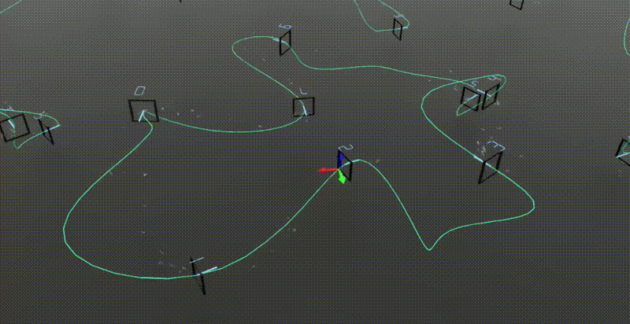

# Autonomous Drone Racing — IsaacLab RL



Reinforcement learning environment for autonomous drone racing built on [IsaacLab](https://isaac-sim.github.io/IsaacLab/). A quadcopter learns to navigate gate circuits using a manager-based RL pipeline.

**New here? Start with [docs/INDEX.md](docs/INDEX.md)**: how the code is organized, where things live, and links to every other document.

---

## Setup

**conda**
```bash
python -m pip install -e source/Racing_Quadcopter
```

**venv**
```bash
pip install -e source/Racing_Quadcopter
```

---

## Training

```bash
# SKRL (recommended)
python scripts/skrl/train.py --task Isaac-Racing-Quadcopter-Manager-v0

# RSL-RL
python scripts/rsl_rl/train.py --task Isaac-Racing-Quadcopter-Manager-v0
```

---

## Evaluation

```bash
# SKRL (recommended)
python scripts/skrl/play.py --task Isaac-Racing-Quadcopter-Manager-Play-v0

# RSL-RL
python scripts/rsl_rl/play.py --task Isaac-Racing-Quadcopter-Manager-Play-v0
```

---

## Other Scripts

```bash
python scripts/random_agent.py --task Isaac-Racing-Quadcopter-Manager-v0   # random action baseline
python scripts/zero_agent.py --task Isaac-Racing-Quadcopter-Manager-v0     # zero action baseline
python scripts/list_envs.py                                               # list registered environments
```

---

## Key Environment Variables

Task behaviour is selected mostly through environment variables read at import time (not `--override`, which is applied after config construction). Common ones:

| Variable | Default | Values |
|---|---|---|
| `DRONE_MODEL` | `crazyflie` | `crazyflie`, `anemos_usd`, `anemos_urdf`, `anemos_sitl` (`anemos_usd` requires running `scripts/tools/generate_anemos_usd.py` first) |
| `ACTION_TYPE` | `rates` | `rates`, `moments` |
| `OBSERVATION_SPACE` | `ours` | `ours`, `mono_race` |
| `RACING_REWARD_PRESET` | `may` | `may`, `current` (changes observation size; use the same value for train and play) |
| `TRACK_YAML` | `configs/tracks/default.yaml` | path to a track YAML (racing `-Fixed-*` tasks only) |
| `HOVERING_DRONE_MODEL` | `anemos_urdf` | `anemos_urdf`, `anemos_usd` |
| `WAYPOINTS` | unset (random per-cell) | path to a hovering waypoint YAML |
| `AI_GP_VARIANT` | `june11` | `june11`, `experimental` (AI-GP task: which frozen snapshot runs) |
| `AI_GP_TRACK_YAML` | unset | AI-GP track override (both variants) |
